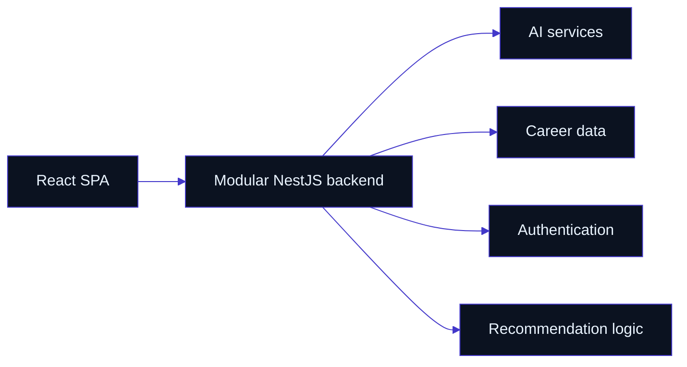
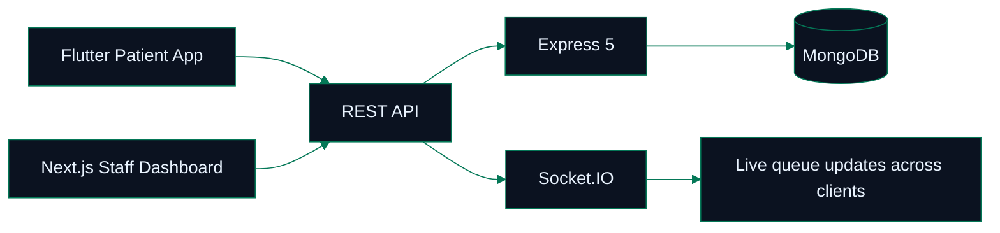

<picture>
  <source media="(prefers-color-scheme: dark)" srcset="https://readme-typing-svg.demolab.com?font=JetBrains+Mono&weight=500&size=17&duration=2800&pause=900&color=67E8F9&center=true&vCenter=true&width=780&height=65&lines=I+turn+real-world+problems+into+working+software.;From+financial+workflows+to+AI-powered+recommendations.;From+real-time+queues+to+interactive+WebGL+experiences.">
  
</picture>

 

  

<b>
<a href="#selected-work">SELECTED WORK</a> &nbsp;·&nbsp;
<a href="#the-toolbox">TOOLBOX</a> &nbsp;·&nbsp;
<a href="#what-i-am-deepening">DEEPENING</a> &nbsp;·&nbsp;
<a href="#github-activity">ACTIVITY</a> &nbsp;·&nbsp;
<a href="#find-me">FIND ME</a>
</b>

## I build software around the way people actually work.

Full-stack developer focused on useful products, dependable backend systems, and intelligent applications. 
I enjoy taking a problem from its first workflow sketch to its database model, API, interface, tests, and deployment.

 

| CURRENT IDENTITY | EDUCATION | ENGINEERING INTERESTS |
|:---:|:---:|:---:|
| Full-Stack Developer · AI/ML Enthusiast | B.Tech CSE · Parul University | Product Engineering · Backend Systems · Applied AI |

 

### MY ENGINEERING LENS

<table>
<tr>
<td align="center" width="15%"><b>01</b> Understand the workflow</td>
<td align="center" width="2%">→</td>
<td align="center" width="15%"><b>02</b> Model the data correctly</td>
<td align="center" width="2%">→</td>
<td align="center" width="15%"><b>03</b> Design clear system boundaries</td>
<td align="center" width="2%">→</td>
<td align="center" width="15%"><b>04</b> Build the product end-to-end</td>
<td align="center" width="2%">→</td>
<td align="center" width="15%"><b>05</b> Test edge cases, not just happy paths</td>
<td align="center" width="2%">→</td>
<td align="center" width="15%"><b>06</b> Ship, observe, and improve</td>
</tr>
</table>

 

I care about the details that make software dependable: financial precision, sensible data models, secure authentication, predictable APIs, real-time state, thoughtful UX, and testable business logic.

 

**Five projects. Five different engineering problems.**

### Projects at a glance

| # | Project | Domain | Core stack | Links |
|:---:|:---|:---|:---|:---|
| 01 | **[Chai Ledger](#chai-ledger)** | Digital khata for small businesses | Next.js · React 19 · MongoDB Atlas · Vitest | [Live](https://ledger-psi-gilt.vercel.app/) · [Source](https://github.com/Vihangpatil37/ledger) |
| 02 | **[SCPR](#scpr)** | Career recommendation platform | React · NestJS · XGBoost · SHAP | [Source](https://github.com/Vihangpatil37/SCPR) |
| 03 | **[NextGen Hospital OPD](#nextgen-hospital-opd)** | Real-time patient registration and queue management | Flutter · Next.js · Express 5 · Socket.IO | [Source](https://github.com/Vihangpatil37/NGO) |
| 04 | **[APEX F1](#apex-f1)** | Immersive Formula 1 web experience | React 19 · Three.js · GSAP · Framer Motion | [Source](https://github.com/Vihangpatil37/APEX) |
| 05 | **[House Price Prediction](#house-price-prediction)** | Property price estimation | Regression-based ML workflow | [Source](https://github.com/Vihangpatil37/House-price-prediction) |

 

<!-- ============================ 01 CHAI LEDGER ============================ -->

### A digital khata built for the realities of Indian small businesses.

 

**The problem:** Paper khatas work until the business needs reliable balances, payment history, reminders, customer context, and safe backups. Chai Ledger brings those everyday workflows into a focused digital ledger without making shopkeepers think like accountants.

**What makes it an engineering project, not just a CRUD app:**

| 💰 Financial correctness | 🧠 Follow-up intelligence | 🛡️ Data safety |
|:---|:---|:---|
| Stores money as integer paise to avoid floating-point drift. | Customer reliability score based on payment behaviour and broken promises. | Recoverable trash, undo flows, JSON backup, and validated CSV import. |
| Keeps due dates and follow-up logic pinned to `Asia/Kolkata`. | Promise-to-pay tracking and urgency-based collection queue. | Duplicate checks and formula-safe CSV export. |

<table>
<tr>
<td width="58%" valign="top">

**Product details**

- Separate **You'll Get / Lene Baaki** and **You'll Give / Advance Jama** views.
- WhatsApp payment nudges and customer statement sharing.
- UPI payment links and dynamic QR codes.
- English, Hindi, and Gujarati localization.
- Customer-wise running ledger, date filters, opening balances, and printable statements.

</td>
<td width="42%" valign="top">

**Engineering choices**

</td>
</tr>
</table>

> [!NOTE]
> **Architecture note:** App-owned authentication with HTTP-only cookie sessions, exact integer currency arithmetic, timezone-aware business rules, and MongoDB-backed ledger data.

> [!TIP]
> **Quality signal:** The repository documents a 187-test suite covering financial arithmetic, date boundaries, deletion/recovery, and translation parity.

<a href="#top">↑ back to top</a>

<!-- ============================ 02 SCPR ============================ -->

### Smart Career Path Recommendation Platform

 

**The problem:** Students, especially those making decisions after Class 10 or Class 12, often face a maze of academic streams and career options. SCPR turns structured student inputs into personalized career guidance through a dedicated recommendation platform.

<table>
<tr>
<td width="58%" valign="top">

**What it brings together**

- Career discovery for Class 10 and Class 12 students across a catalog of 130+ career paths.
- A modular recommendation engine with structured scoring and hybrid ranking.
- Machine-learning support using Random Forest and XGBoost, with SHAP-based explainability.
- AI-service layer for LLM routing and prompt management.
- Authentication and role-based access control.
- Security-focused request handling and output sanitization.

</td>
<td width="42%" valign="top">

**Engineering choices**

</td>
</tr>
</table>

**Architecture**

> [!NOTE]
> **Architecture note:** A React SPA communicates with a modular NestJS backend. The backend separates AI services, career data, authentication, and recommendation logic instead of placing everything in one large application module.

**What I focus on here:** Recommendation quality, explainable decision paths, safe AI integration, and keeping the platform modular as the career catalog and recommendation logic grow.

<a href="#top">↑ back to top</a>

<!-- ============================ 03 HOSPITAL OPD ============================ -->

### Real-time patient registration and queue management

 

**The problem:** Busy OPD workflows can mean early-morning queues, manual registration, and staff coordinating patient flow across multiple counters. This project digitizes patient registration and gives hospital staff a live queue to operate.

<table>
<tr>
<td width="58%" valign="top">

**The system**

- Flutter patient app with Gujarati, Hindi, and English.
- New and returning patient registration.
- Automatically generated queue tokens.
- Next.js staff dashboard for calling, skipping, and completing patients.
- Doctor availability module.
- Searchable patient directory and configurable registration windows.

</td>
<td width="42%" valign="top">

**Engineering choices**

</td>
</tr>
</table>

**Real-time flow**

> [!NOTE]
> **Backend details:** Separate staff, patient, and doctor authentication flows; atomic token counters per registration window; API validation with Zod; structured logging with Pino.

**What I focus on here:** Consistent queue state, real-time event delivery, role boundaries, and designing a workflow that works for patients and hospital staff rather than only looking good in a demo.

<a href="#top">↑ back to top</a>

<!-- ============================ 04 APEX F1 ============================ -->

### An immersive Formula 1 web experience

 

**The idea:** A high-performance F1 landing-page experience where motion and visual atmosphere are part of the product, not decoration added at the end.

<table>
<tr>
<td width="58%" valign="top">

**What went into it**

- Three.js / WebGL wind-tunnel particle effects.
- GSAP staggered text reveals and scroll-triggered motion.
- Framer Motion transitions.
- Responsive, mobile-first layouts.
- Semantic markup and accessibility considerations.
- Unit and end-to-end testing setup.

</td>
<td width="42%" valign="top">

**Engineering choices**

</td>
</tr>
</table>

**What I focus on here:** Balancing visual intensity with performance, responsive behaviour, accessibility, and maintainable component structure.

<a href="#top">↑ back to top</a>

<!-- ============================ 05 HOUSE PRICE ============================ -->

### Property price estimation from real-world features

 

**The problem:** Property pricing depends on more than a single number. Location, locality, usable area, and property configuration all influence an estimate.

This project explores house-price prediction through structured property information and a machine-learning workflow.

**Project focus**

- Use property attributes such as location, area, and room configuration as model inputs.
- Prepare and transform property data for prediction.
- Apply regression-based price estimation.
- Present the result in a form that is understandable to a user evaluating a property.

> [!NOTE]
> **Engineering theme:** Turning structured real-estate data into a practical estimation workflow, connecting data preparation and predictive logic to a user-facing product.

<a href="#top">↑ back to top</a>

 

**I choose tools based on the system being built rather than forcing every project into the same stack.**

 

| Layer | Tools |
|:---|:---|
| **LANGUAGES** |  |
| **FRONTEND & MOBILE** |  |
| **BACKEND & DATA** |  |
| **AI / ML** |  `XGBoost` · `SHAP` · `LLM Integration` · `Recommendation Systems` |
| **TOOLS & DELIVERY** |  |

### Areas I work across

| Product layer | What I build / work with |
|:---|:---|
| **Interface** | Responsive React and Next.js apps, Flutter applications, interaction design |
| **Application backend** | REST APIs, modular services, authentication, validation, background jobs |
| **Data** | MongoDB, Mongoose, schema design, indexes, data integrity |
| **Real-time** | Socket.IO, event-driven updates, synchronized client state |
| **AI / ML** | Recommendation workflows, model-driven prediction, LLM integration, explainable AI concepts |
| **Quality** | Unit tests, integration tests, E2E tests, type checking, linting |
| **Delivery** | Git, GitHub, Vercel, Render, Docker, Linux |

 

<table>
<tr>
<td width="50%" valign="top">

**01 · BACKEND ENGINEERING** 
API design · Data modelling · Authentication · System design

</td>
<td width="50%" valign="top">

**02 · INTELLIGENT APPLICATIONS** 
LLM orchestration · RAG · Agentic workflows · Recommendation systems

</td>
</tr>
<tr>
<td width="50%" valign="top">

**03 · RELIABLE SYSTEMS** 
Real-time communication · Validation · Testing · Observability

</td>
<td width="50%" valign="top">

**04 · PRODUCT THINKING** 
User workflows · Useful defaults · Accessibility · Practical UX

</td>
</tr>
</table>

*I prefer understanding why a system is designed a certain way, not just getting it to run.*

 

<picture>
  <source media="(prefers-color-scheme: dark)" srcset="https://github-readme-stats.vercel.app/api?username=Vihangpatil37&show_icons=true&hide_border=true&bg_color=0D1117&title_color=67E8F9&text_color=C9D1D9&icon_color=38BDF8&rank_icon=github">
  
</picture>
<picture>
  <source media="(prefers-color-scheme: dark)" srcset="https://github-readme-stats.vercel.app/api/top-langs/?username=Vihangpatil37&layout=compact&hide_border=true&bg_color=0D1117&title_color=67E8F9&text_color=C9D1D9&langs_count=8">
  
</picture>

  

<picture>
  <source media="(prefers-color-scheme: dark)" srcset="https://github-readme-activity-graph.vercel.app/graph?username=Vihangpatil37&bg_color=0D1117&color=C9D1D9&line=38BDF8&point=67E8F9&area=true&hide_border=true">
  
</picture>

 

 

  

**I like building things that solve a real problem, and understanding every layer that makes them work.**

